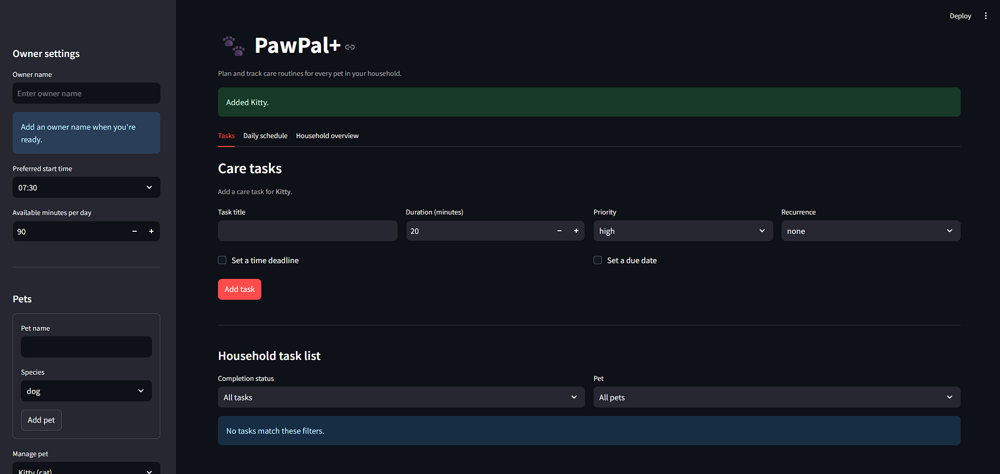

# PawPal+ (Module 2 Project)

You are building **PawPal+**, a Streamlit app that helps a pet owner plan care tasks for their pet.

## Scenario

A busy pet owner needs help staying consistent with pet care. They want an assistant that can:

- Track pet care tasks (walks, feeding, meds, enrichment, grooming, etc.)
- Consider constraints (time available, priority, owner preferences)
- Produce a daily plan and explain why it chose that plan

Your job is to design the system first (UML), then implement the logic in Python, then connect it to the Streamlit UI.

## What you will build

Your final app should:

- Let a user enter basic owner + pet info
- Let a user add/edit tasks (duration + priority at minimum)
- Generate a daily schedule/plan based on constraints and priorities
- Display the plan clearly (and ideally explain the reasoning)
- Include tests for the most important scheduling behaviors

## Getting started

### Setup

```bash
python -m venv .venv
source .venv/bin/activate  # Windows: .venv\Scripts\activate
pip install -r requirements.txt
```

### Suggested workflow

1. Read the scenario carefully and identify requirements and edge cases.
2. Draft a UML diagram (classes, attributes, methods, relationships).
3. Convert UML into Python class stubs (no logic yet).
4. Implement scheduling logic in small increments.
5. Add tests to verify key behaviors.
6. Connect your logic to the Streamlit UI in `app.py`.
7. Refine UML so it matches what you actually built.

## 🖥️ Sample Output

```
Today's Schedule - Friday, November 13, 2026
07:30 AM-07:40 AM | Mochi - Breakfast (10 min, priority: high)
07:40 AM-07:50 AM | Nori - Feeding (10 min, priority: high)
07:50 AM-08:20 AM | Mochi - Morning walk (30 min, priority: high)
08:20 AM-08:40 AM | Nori - Playtime (20 min, priority: medium)
```

## 🧪 Testing PawPal+

```bash
# Run the full test suite:
pytest

# Run with coverage:
pytest --cov
```

Sample test output:

```
tests\test_pawpal.py ................                                                                                                                                [100%]

=========================================================================== 16 passed in 0.03s ============================================================================
```

## 📐 Smarter Scheduling

> Fill in once you've implemented scheduling logic.

| Feature | Method(s) | Notes |
|---------|-----------|-------|
| Task sorting | `Scheduler.sort_by_time()` | Orders tasks by deadline; tasks without a deadline come last. |
| Filtering | `Scheduler.filter_tasks()` | Filters by completion status and/or pet name. |
| Conflict handling | `Scheduler.detect_conflicts()` | Warns when scheduled intervals overlap, including tasks belonging to different pets. |
| Recurring tasks | `Pet.mark_task_complete()`, `Task.mark_complete()` | Daily tasks recur one day after completion; weekly tasks recur seven days later. Future-dated occurrences are excluded from earlier plans. |

## 📸 Demo Walkthrough

Describe your app in numbered steps so a reader can follow along without watching a video:

1. On the left panel, add the owner name and fill out the preferred start time and available minutes per day that the owner can do tasks.
2. Create your pets: Add a pet name and species, then click add pet. Do this for every pet the owner has.
3. In the manage pet dropdown, select your pet to create a task for that pet specifically. When the correct pet is selected, fill out the care task fields including Task title, duration, priority, recurrence, and if it has deadlines. When satisfied, click "Add Task" to add it to the list.
4. You can add more tasks as needed for that pet. To add tasks to other pets, click the manage pet dropdown and select the other pet. Repeat step 3 as many times as needed.
5. Click the "Daily Schedule" tab to view the schedule that has been generated.
6. When a task is completed, navigate back to the "Tasks" tab and click "Complete: [Task Name]" to take it off the daily schedule.

**Screenshot or video**
